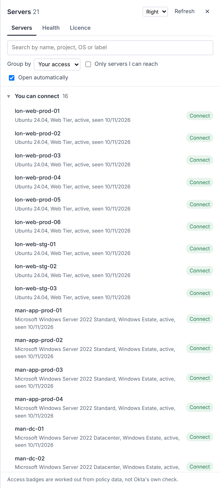
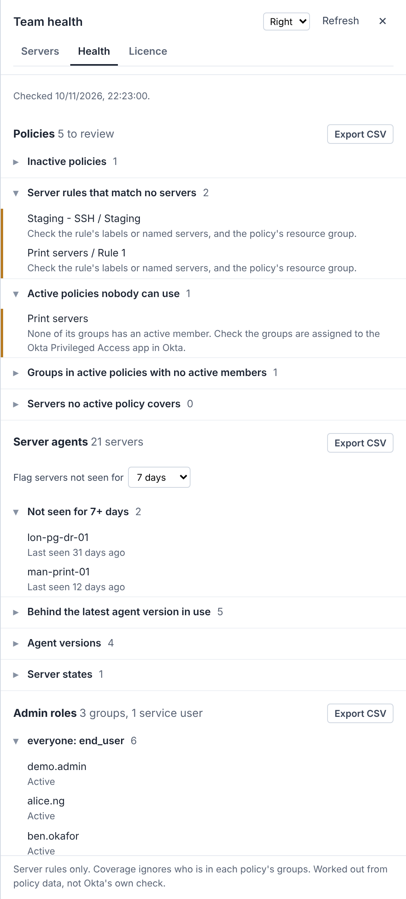
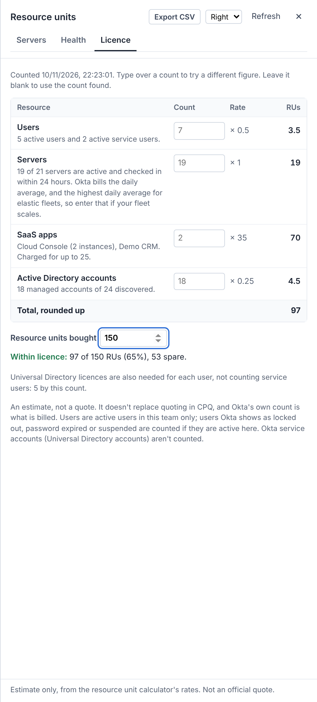
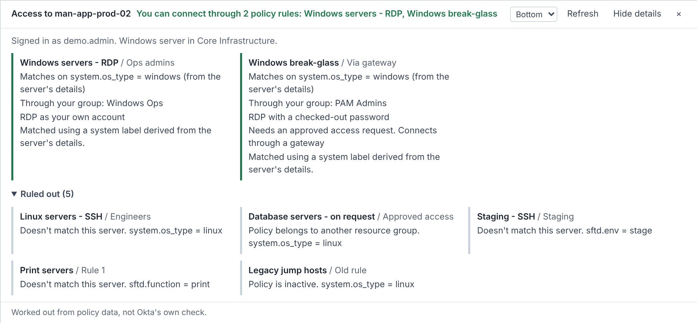
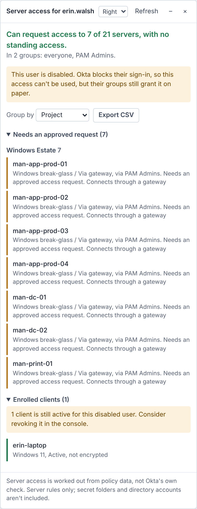

# OPA Optics

See who can reach what in Okta Privileged Access, and why.

OPA Optics is a browser tool for the Okta Privileged Access console. It groups and searches your servers, explains which security policy gives someone access to a server, lists a user's server access and enrolled clients, checks your team for common policy, agent and admin-role problems, and estimates your resource unit (licence) use.

> **Unofficial.** OPA Optics is not made, supported or endorsed by Okta. "Okta" and "Okta Privileged Access" are trademarks of Okta, Inc., used here only to describe what the tool works with.

---

## Contents

- [Screenshots](#screenshots)
- [Features](#features)
- [Install](#install)
- [Using it](#using-it)
- [Who can use what](#who-can-use-what)
- [How it works](#how-it-works)
- [Data handling and security](#data-handling-and-security)
- [Limitations](#limitations)
- [Checking results against Okta](#checking-results-against-okta)
- [Repository layout and building](#repository-layout-and-building)
- [Reporting problems](#reporting-problems)
- [Licence](#licence)

---

## Features

### Grouped server list (home page)

On `/t/{team}/home`, a list of servers opens on the right-hand side of the page.

- Group by project, server type, name prefix (first 1, 2 or 3 parts of the hostname), label, or your own access.
- Search by hostname, project, operating system or label value.
- Admins see a badge on each server: **Connect**, **Request** or **No access**, and can filter to servers they can reach.
- Clicking a server opens its Accounts page.
- Opens automatically on the home page. Untick **Open automatically** to open it from the **Grouped servers** button instead.

### Health tab (admins)

A second tab in the same list checks the whole team:

- **Policies:** inactive policies, server rules that match no servers, active policies whose groups have no active members, and servers that no active policy covers.
- **Server agents:** servers not seen for a chosen number of days, servers behind the newest agent version in use, and counts by agent version and state.
- **Admin roles:** groups holding admin roles and their members (inactive members flagged), and service users with role grants.

Each section has its own CSV export.

### Licence tab (admins)

A third tab estimates resource units, using the rates from Okta's resource unit calculator:

| Resource | What it counts | Rate |
| --- | --- | --- |
| Users | Active users and active service users in the team | 0.5 RU each |
| Servers | Active servers that checked in within the last 24 hours | 1 RU each |
| SaaS apps | Connected SaaS apps. Several instances of the same app count once. Okta itself isn't counted | 35 RU each, charged for up to 25 apps (875 RU) |
| Active Directory accounts | Accounts brought under management (assigned to a project) | 0.25 RU each |

The total is rounded up.

- Type over any count to try a different figure. Leave it blank to go back to the count found. Typed figures are forgotten when you reload the page.
- Enter the number of resource units bought to see how much is spare or over. This number is saved per team in your browser.
- It also shows how many Universal Directory licences your users need (service users excluded).
- Export the estimate as CSV.

**This is an estimate, not a quote.** It doesn't replace quoting in CPQ, and Okta's own count is what's billed. In particular:

- Okta bills servers on a daily average, and elastic fleets on the highest daily average. The tool sees only the servers checked in right now, so enter the peak average yourself if your fleet scales up and down.
- Users are counted by their status in Okta Privileged Access. Okta's rules also count users who are locked out, password expired or suspended in Okta; these are counted here only if they're still active in Okta Privileged Access.
- Okta service accounts (Universal Directory accounts) aren't counted, as the calculator doesn't list them.
- If your account can't read users, SaaS apps or Active Directory accounts, that row says so and you can enter a figure.

### "Why do I have access?" (server pages)

On `/t/{team}/servers/{id}/...`, a banner along the bottom of the page shows:

- whether you can connect to the server, can request access, or have no access;
- each policy rule that applies, what it matched on (for example `system.os_type = windows`), and through which of your groups;
- the privileges granted (for example RDP as your own account) and any conditions (approved access request, gateway);
- rules covering the server for other groups, and rules ruled out, with the reason.

The banner's top line always shows the answer and the policies behind it. **Hide details** shrinks the banner to that one line, and your choice is remembered.

### Panel position

Each panel has a **Position** setting. The server panel can sit along the bottom (the default), on the right or on the left. The grouped server list and the user panel can sit on the right or the left. The bottom and left positions sit beside the console's left-hand menu rather than over it. The tool finds the menu by measuring the page, so if the console's layout changes and a panel overlaps the menu, use another position and report it.

### User access (user pages)

On `/t/{team}/users/u/{user}`, a panel shows:

- every server the user can reach, split into **standing access** and **needs an approved request**, with the policy, rule and group behind each;
- the user's groups;
- devices (clients) the user has enrolled, with a warning when a disabled or deleted user still has active clients;
- a CSV export of every grant, for access reviews.

---

## Screenshots

Shown with fictional demo data.

| Grouped servers | Health tab |
| --- | --- |
|  |  |

| Licence tab | |
| --- | --- |
|  | |

| Why do I have access? | User access |
| --- | --- |
|  |  |

---

## Install

Choose one method. Don't use more than one at the same time.

### Option 1: Userscript manager (recommended)

Runs automatically on every Okta Privileged Access page and updates itself when a new version is released. Use [Violentmonkey](https://violentmonkey.github.io/) (open source) or Tampermonkey.

1. Install Violentmonkey or Tampermonkey in your browser.
2. If your browser has an **Allow User Scripts** setting for the extension (Chrome and Edge: the extension's **Details** page), turn it on. On some versions you turn on **Developer mode** on the extensions page instead. If the script installs but never runs, this setting is almost always why.
3. Open the install link: [`opa-optics.user.js`](https://raw.githubusercontent.com/JayToll/opa-optics/main/opa-optics.user.js). Your userscript manager offers to install it. Click **Install**.
4. Open your console's home page. The server list appears.

Install from the link rather than a downloaded copy, so updates arrive automatically. If you'd rather review each new version first, turn off automatic updates for the script in your userscript manager.

The script runs on `https://*.pam.okta.com/t/*` and `https://*.pam.oktapreview.com/t/*`. If your team uses a different address, add a matching `@match` line at the top of the script.

Your userscript manager checks this repository for new versions and offers to update. Updating means running new code in your Okta Privileged Access console, so review the [changes](CHANGELOG.md) first if your organisation requires it.

### Option 2: Bookmarklet

No extension needed, but you click it each time you open the console.

1. Open the [install page](https://jaytoll.github.io/opa-optics/).
2. Show your bookmarks bar (Ctrl+Shift+B, or Cmd+Shift+B on a Mac) and drag the **OPA Optics** button onto it.
3. In the console, click the bookmark. It keeps running as you move around the console. Click it again after a full page reload or after signing in again.

The bookmarklet holds the whole tool, so it is large (about 60 KB). After saving it, check the bookmark's address wasn't cut short.

### Option 3: Console paste (testing)

Open your browser's developer tools on a console page, paste the contents of [`opa-optics.user.js`](opa-optics.user.js) into the Console tab, and press Enter.

---

## Using it

| Page | What appears |
| --- | --- |
| `/t/{team}/home` | Grouped server list and, for admins, the Health and Licence tabs |
| `/t/{team}/servers/{id}/...` | "Access to this server" banner along the bottom of the page |
| `/t/{team}/users/u/{user}` | "Server access" panel for that user |

Panels follow you as you move around the console. Each has **Refresh** (reloads policies, groups and servers), collapse and close buttons. Closing a panel hides it until you move to another server or user.

Your grouping choices are remembered in your browser for that console.

---

## Who can use what

| Feature | Needs |
| --- | --- |
| Grouped server list | Permission to list servers |
| Access badges, server panel, user panel, Health and Licence tabs | Permission to read security policies (admin roles such as security admin or PAM admin) |
| SaaS app and Active Directory counts on the Licence tab | Permission to list SaaS apps and Active Directory accounts |
| Enrolled clients on the user panel | Permission to list other users' clients |
| Service users in the Health tab | Permission to list service users |

Features you can't use are hidden or show a short message. Everything else keeps working.

---

## How it works

- **Sign-in.** The console keeps your session token in a cookie named `SFT_logged-in_store_{team}`. OPA Optics reads it for each request and sends it as a `Bearer` token to the Okta Privileged Access API on the same address. It uses the token of the team in the page address only, so one team's token is never sent to another team.
- **Data it reads.** Servers, security policies, resource groups and their projects, groups and their members, users, service users, clients, connected SaaS apps and Active Directory accounts, all through the `/v1/teams/{team}/...` API. It follows paging and waits when the API's rate limit is reached.
- **Working out access.** For each server rule in each policy, it checks that:
  1. the policy is active;
  2. the policy applies to all resource groups, or to the server's resource group;
  3. the rule's selector matches the server: a named server, or labels;
  4. the person is in one of the policy's groups.

  Labels are compared exactly. The `system.os_type` and `system.hostname` labels are worked out from the server's own details, because the API can return servers with no stored labels even when rules select on these.
- **Caching.** Policies, groups and servers load once per team and are reused across pages until you press **Refresh**.
- **Page changes.** The console changes pages without reloading, so OPA Optics checks the address once a second and shows or hides its panels to match.

---

## Data handling and security

- **Read-only.** OPA Optics only makes `GET` requests. It never changes anything in Okta Privileged Access.
- **Same address only.** Requests go only to the Okta Privileged Access address you are signed in to.
- **No token storage.** Your session token is read when needed and never stored, logged or sent anywhere else.
- **Local settings only.** Your grouping choices are saved in your browser's local storage under `opa-optics.grouped`, and the number of resource units bought, per team, under `opa-optics.licence`.
- **CSV exports contain access data.** They include usernames, server names and access details. Store and share them like any other access review evidence. Cells starting with `=`, `+`, `-` or `@` get an apostrophe added, so spreadsheet programs don't run them as formulas.
- **Isolated display.** Panels are drawn in an isolated layer of the page (a shadow root), and all text from the API is escaped before display.

If your organisation controls browser extensions or scripts, check its rules before installing. Userscript managers can run on every website, which is much broader than OPA Optics needs, so some organisations block it on managed devices.

---

## Limitations

- **Not Okta's own check.** Access results are reconstructed from policy data. Treat them as guidance, and confirm anything important in the console.
- **Server rules only.** Secret folder and Active Directory rules aren't evaluated yet.
- **Some labels aren't evaluated.** Only `system.os_type` and `system.hostname` are worked out from server details. Rules on other system labels show as "couldn't check" rather than "doesn't match".
- **Simple label rules only.** It assumes each label selector uses single text values. Selectors with several labels or lists of values haven't been tested against Okta's behaviour.
- **Conditions are shown, not evaluated.** Access requests, gateways and MFA are listed against each rule, but the tool doesn't check whether a request has been approved.
- **"Latest agent" means latest on your team**, not Okta's newest release.
- **Undocumented details.** The tool depends on the console's session cookie name and page addresses, which Okta doesn't document. These rarely change, and when they do the fix is usually small: report it and a new version will follow.
- **Tested on one team so far.** Reports from other setups are welcome, especially EMEA addresses, large teams and different label conventions.

---

## Checking results against Okta

Before relying on OPA Optics for audit evidence, compare it with Okta's own answer:

1. In the console, create an access report for a user or a server. Do this on a preview or demo team, or with the team owner's agreement, because it creates a stored report.
2. Compare the report with OPA Optics' user or server panel for the same user or server.
3. If they differ, please [open an issue](../../issues) with the rule type involved (no names or tenant details).

---

## Repository layout and building

| Path | What it is |
| --- | --- |
| `opa-optics.user.js` | The tool. Readable source, the Tampermonkey install and the update source. No dependencies |
| `opa-optics-bookmarklet.txt` | The bookmarklet, built from the source |
| `docs/index.html` | The install page, served by GitHub Pages. Built from the source |
| `build/` | The build script and install page template |

The bookmarklet is the minified source with a small amount of URL encoding. To rebuild it and the install page after changing the source, with Node.js installed:

```bash
npm install
npm run build
```

The build checks that the bookmarklet decodes back to the minified code and that the code parses. Anyone can run it to confirm the published bookmarklet matches the readable source.

### Releasing a new version

1. Change `opa-optics.user.js` and raise its `@version` number. Tampermonkey only offers updates when this number goes up.
2. Run `npm run build`.
3. Add the changes to [CHANGELOG.md](CHANGELOG.md).
4. Commit the source, `opa-optics-bookmarklet.txt` and `docs/index.html` together.
5. Tag the release, for example `v1.5.2`, and create a GitHub release with the changelog notes.

---

## Reporting problems

- **Bugs and ideas:** open an issue. Please leave out tenant names, hostnames, usernames, console logs and screenshots from real teams.
- **Security issues:** don't open a public issue. See [SECURITY.md](SECURITY.md) for how to report privately.

---

## Changes

See [CHANGELOG.md](CHANGELOG.md).

---

## Licence

Released under the MIT Licence. See [LICENSE](LICENSE).
